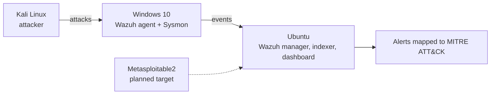

# 🛡️ Wazuh SOC Home Lab

A home SOC lab where attacks from Kali are detected by custom Wazuh rules and
mapped to MITRE ATT&CK.

## 🧭 Architecture

| Machine | Role |
|---|---|
| Ubuntu | Wazuh Manager, Indexer, Dashboard (4.7.5) |
| Windows 10 | Monitored endpoint: Wazuh agent + Sysmon |
| Kali Linux | Attacker |
| Metasploitable2 | Vulnerable target (planned) |

## 🎯 Detections

| Rule | Detects | MITRE | Status |
|---|---|---|---|
| 100100 | PowerShell process execution | T1059.001 | ✅ Working |
| 100101 | Suspicious PowerShell arguments (-enc, hidden window) | T1059.001 | ✅ Working |
| 100102 | Execution from a temp folder | T1204 | ✅ Working |
| Planned | SSH brute force, Windows brute force, masquerading, persistence, new user, file integrity | T1110, T1036, T1547, T1136 | ⬜ |

## 🧪 Test results

| Attack | Alert fired | Time to alert | Notes |
|---|---|---|---|
| Hidden PowerShell with encoded-style arguments | Yes | <seconds> | Rule 100101 |
| Plain PowerShell launch | Yes | <seconds> | Rule 100100 |
| Execution from a temp folder | Yes | <seconds> | Rule 100102 |

## 🔧 Troubleshooting highlights
- Sysmon events never arrived because the agent had not loaded the Sysmon channel. Found by reading the agent log, fixed by re-adding the config block.
- Child rule 100101 did not fire until I simplified the pattern and restarted the manager.

Full record: [docs/troubleshooting-log.md](docs/troubleshooting-log.md)

## 🗺️ Roadmap
- [x] Wazuh manager, agent, Sysmon forwarding
- [x] PowerShell detections
- [ ] Temp-folder and masquerading detection
- [ ] SSH brute force from Kali with my Python analyzer
- [ ] Atomic Red Team tests
- [ ] File integrity monitoring and active response
