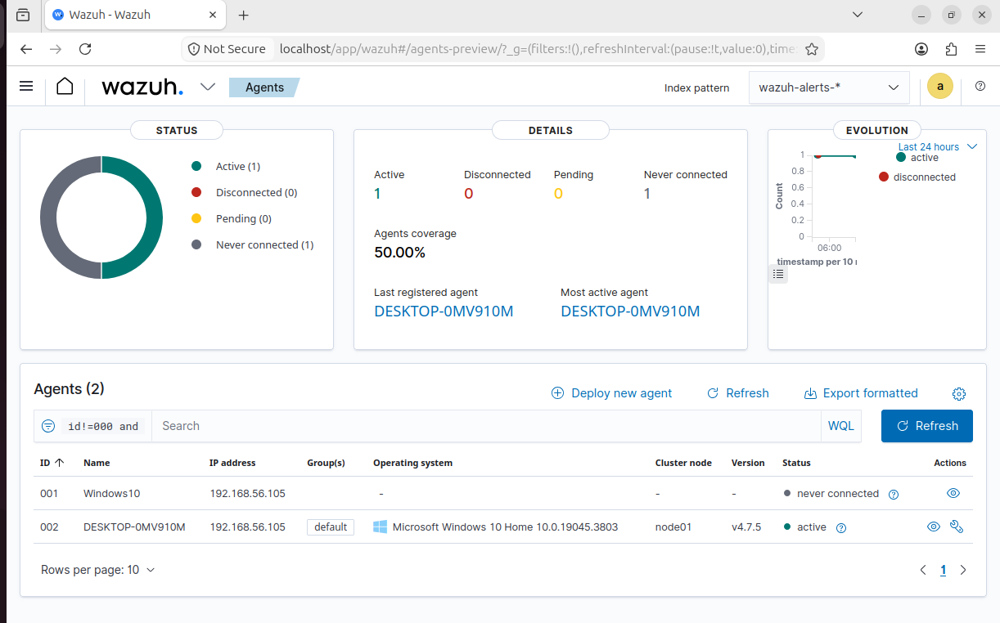
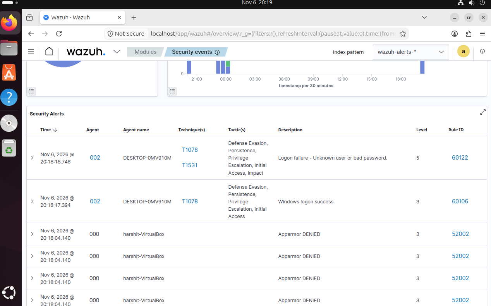

# Wazuh SOC Home Lab

A virtual blue-team lab for practising detection and investigation: a SIEM, an
endpoint with Sysmon telemetry, an attacker machine and a vulnerable target.

## Architecture
| Machine | Role |
|---|---|
| Ubuntu VM | Wazuh Manager, Indexer and Dashboard (4.7.5) |
| Windows 10 VM | Wazuh Agent + Sysmon (monitored endpoint) |
| Kali Linux VM | Attacker |
| Metasploitable2 | Vulnerable target |

All machines run in VirtualBox on a host-only network.

## Status
- [x] Wazuh Manager installed on Ubuntu
- [x] Windows agent installed, version matched to the manager, status Active
- [x] Windows failed logins (Event ID 4625) reaching the dashboard
- [x] Sysmon installed, generating events locally (Event ID 1, 5)
- [x] Agent configured to read the Sysmon event channel
- [x] Archive logging enabled on the manager
- [ ] Sysmon events visible in the dashboard *(in progress, see troubleshooting log)*
- [ ] Kali attack simulations
- [ ] Custom detection rules
- [ ] Case studies

## Evidence

*Windows agent connected and Active.*

*Event ID 4625 events from the Windows VM in the Wazuh dashboard.*

## Troubleshooting
The full record of what broke and how I fixed it is in
[docs/troubleshooting-log.md](docs/troubleshooting-log.md).

## Next
Attack the Windows VM from Kali, find the activity in Wazuh, and write detection
rules and case studies.
